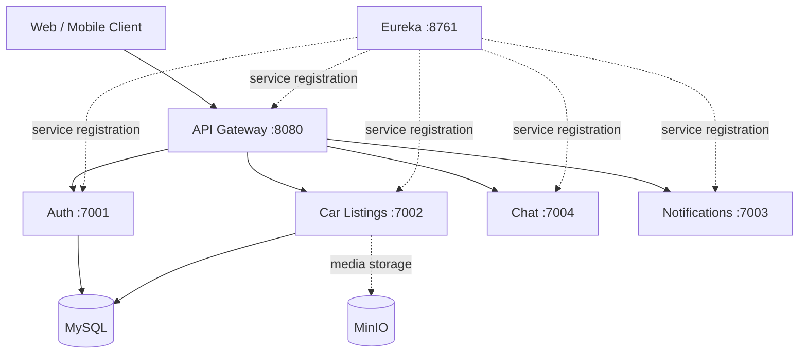

# CarHub360 — Spring Boot Microservices Backend

A Java 17 / Spring Boot 3.2.5 multi-module backend for a used-car marketplace. This repository retains some legacy **CarVerse** identifiers in Maven coordinates and packages; product branding is **CarHub360**.

> **Engineering portfolio note:** This is a development codebase, not a claim of a fully audited or production-hardened deployment. Check environment-specific settings and security controls before public deployment.

## Architecture



The diagram shows logical relationships. Actual integrations and environment configuration should be checked in each service.

## Modules

| Module | Default port | Responsibility |
| --- | ---: | --- |
| `discovery-service` | 8761 | Eureka service registry |
| `gateway-service` | 8080 | API routing / gateway |
| `auth-service` | 7001 | Authentication and identity |
| `car-listing-service` | 7002 | Vehicle listings and media |
| `notification-service` | 7003 | Notifications |
| `chat-service` | 7004 | Buyer–seller conversations |

Root Maven aggregator includes all six modules. The checked-in `docker-compose.yaml` currently does **not** define the chat service, Redis, or MinIO; starting Compose alone is not an end-to-end deployment.

## Technology

Java 17 · Spring Boot 3.2.5 · Spring Cloud 2023.0.1 · Maven · Spring Security · Spring Data JPA · MySQL · Eureka · Docker Compose · Jenkins · GitHub Actions. Some modules also use JWT libraries, Flyway, and MinIO.

## Getting started (development)

### Prerequisites
- JDK 17, Maven, Docker with Compose
- Configuration and dependent services required by individual Spring profiles

### Build and test
```bash
mvn -B -ntp clean verify
```

This runs Maven's verification lifecycle, including test phases. Tests may still need databases or other services depending on their setup.

### Local container configuration
```bash
docker compose -f docker-compose.yaml config
docker compose -f docker-compose.yaml up --build
```

**Do not expose the checked-in Compose configuration publicly.** It currently contains a hardcoded local development MySQL root password, published ports, and incomplete service dependencies. Replace development credentials with securely supplied configuration, review networking, and add missing infrastructure before deployment.

## CI/CD

- GitHub Actions: `.github/workflows/maven-ci.yml` uses Java 17 and `mvn -B -ntp clean verify`, uploading test reports where available.
- Jenkins: `Jenkinsfile` packages the modules and builds/pushes the gateway Docker image; the portfolio branch removes the previous explicit test-skip flag. Docker Hub credentials are expected from the Jenkins credential store.

**Validation status:** Changes in this PR should be treated as unverified until GitHub Actions completes successfully. A successful build does not establish end-to-end integration or security readiness.

## Engineering review priorities

1. Move hardcoded development database credentials to environment variables and rotate any real credentials ever shared.
2. Review Spring Security rules, JWT lifecycle, input validation, tenant/ownership authorization, CORS, and internal-service authentication.
3. Add reliable unit and integration tests, including database/container-backed coverage.
4. Bring Docker Compose up to date with the actual topology (chat, Redis, MinIO, health checks).
5. Review dependency updates and vulnerability alerts; validate on a staging environment.
6. Document deployment, API contracts, failure handling, monitoring, and architecture decisions.

## Repository layout

```text
auth-service/
car-listing-service/
chat-service/
discovery-service/
gateway-service/
notification-service/
.github/workflows/maven-ci.yml
docker-compose.yaml
Jenkinsfile
pom.xml
```

## Ownership

Personal engineering project associated with EpitomeHub. Do not reuse this code or assets without checking applicable licensing and third-party dependencies. No open-source license is asserted by this README.
